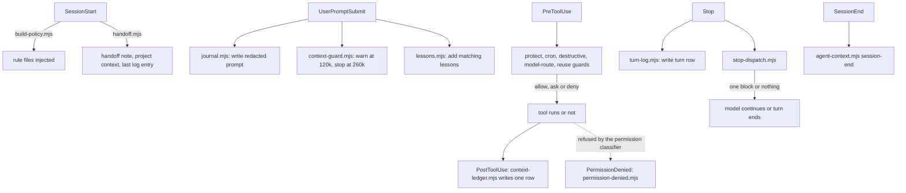

# Architecture

Keelson has no daemon. Claude Code (or Codex) starts a `node` process for each hook event, passes the event as JSON on stdin, reads stdout, and the process exits. All state is in plain files.

## Hook flow in one session



The same events, in a table, with the matchers: see "What each hook does" in the README. `hooks/hooks.json` in the plugin folder is the source of truth.

## The Stop dispatcher

Claude Code runs every Stop hook it finds. If six checks each blocked, the model would get six separate turns of complaints, and each turn resends the whole context. `stop-dispatch.mjs` runs the checks in parallel and merges the result into one reply.

```
Stop event (JSON on stdin)
        |
        v
  stop-dispatch.mjs
        |  spawns each check with the same stdin, in parallel
        +--> stop-evidence-guard.mjs --+
        +--> claims-guard.mjs ---------+
        +--> review-guard.mjs ---------+--> verdicts
        +--> wake-guard.mjs -----------+
        +--> push-first-guard.mjs -----+
        +--> quality-gate.mjs ---------+
        |
        v
  0 blocks   -> prints nothing, the turn ends
  1 block    -> {"decision":"block","reason":"..."}
  2+ blocks  -> one block, a numbered list of the reasons
```

Each check gives one verdict:

| Check output | Verdict |
|---|---|
| Exit 0, no output | pass |
| Exit 0, JSON with `"decision":"block"` | block, with its `reason` |
| Exit 2, text on stderr | block, with the stderr text as the reason |
| Exit 0, other JSON (for example `systemMessage`) | pass, the extra fields are kept and merged |
| Any other exit code, output that is not JSON, or a crash | error: the turn is not blocked |
| No answer within 15 s (90 s for `quality-gate.mjs`) | timeout: the turn is not blocked |

A broken check never blocks you. The dispatcher also stays silent when the session already got its context-limit warning and the context is over the stop threshold, so a session that must hand off is not held up by more complaints. Every run is logged to `~/.agent/hook-runs.jsonl` with the verdict of each check and the total time.

`KEELSON_STOP_CHECKS` (a comma-separated list of script names) replaces the default list; names that do not exist in the scripts folder are skipped.

## The quality gate

`quality-gate.mjs` looks at the files changed in the turn (git status and diff, since the turn started) and runs, in order of trust:

- Always: `node --check` for `.mjs`, `bash -n` for `.sh`, a check for stray files in the repository root, and, if the project's `.agent/project.yaml` or the package quality config forbids comments, a check for new comments.
- For any repository: linters found on your PATH (for example ruff, eslint) on the changed files.
- Only for repositories you trusted with `node <plugin-dir>/scripts/quality-gate.mjs trust <repo>`: the commands listed under `turn_checks` in `.agent/project.yaml`, affected tests, and linters from the repository's own `.venv` and `node_modules`.

Custom regular-expression rules from `.agent/rules/<id>.json` run over the added lines. In an untrusted repository they run in shadow mode. Shadow mode only logs the match to `hook-runs.jsonl`.

## Data files

All paths are under `~/.agent` unless stated. The table of what each file holds is in the README.

| File | Written by | Read by |
|---|---|---|
| `journal/YYYY-MM.jsonl` | `journal.mjs` | `recall.mjs`, `dashboard.mjs` |
| `turns.jsonl` | `turn-log.mjs` | `dashboard.mjs`, `context-ledger.mjs --cost` (project names) |
| `context-ledger/<session>.jsonl` | `context-ledger.mjs` | `context-ledger.mjs --cost` and `--report`, `dashboard.mjs` |
| `findings.jsonl` | `findings.mjs add`, the review subagent, the quality gate | `findings.mjs stats` and `acted`, `learn.mjs`, `dashboard.mjs` |
| `lessons.jsonl` | `lessons.mjs add` | `lessons.mjs` hook, `lessons.mjs list`, `dashboard.mjs` |
| `handoff/` | `handoff.mjs write` | `handoff.mjs` hook and `show`, `recall.mjs` |
| `hook-runs.jsonl` | `stop-dispatch.mjs` and other guards | your own `node -e`, jq or the weekly review |
| `denials.jsonl` | `permission-denied.mjs` | `dashboard.mjs` |
| `board/` | `turn-log.mjs` | `board.mjs` |
| `context-guard.json` and other `*.json` | the guards | the guards: which warnings were already given in which session |
| `trusted-repos.txt` | `quality-gate.mjs trust` | `quality-gate.mjs` |
| `reviews/<date>.md` | `/keelson:weekly-review` | you, and the next weekly review |

In each repository: `.agent/context.md`, `.agent/log.md` (or `.agent/log/<date>-<branch>.md` on task branches), `.agent/decisions/`, `.agent/incidents/`, `.agent/map.md`, plus optional `.agent/project.yaml`, `.agent/conventions.json`, `.agent/protected` and `.agent/rules/`. They are meant to be committed.

## Layout of the package

```
plugins/keelson/
  hooks/hooks.json     the 16 hook entries
  scripts/*.mjs        one script per hook or command, no dependencies beyond Node
  scripts/lib/         shared code: redaction, transcript parsing, ledger, findings
  scripts/checks/      checks used by the quality gate
  global/rules.d/      rule files injected at SessionStart
  skills/  agents/     skills and subagents
  commands/            slash commands (/keelson:weekly-review)
  evals/               behavioral cases for the rules
```

Scripts import only from `scripts/lib` and Node's standard library. There is no `package.json` and nothing to install.

## Why plain files

A provider account can be lost, a tool can change. Plain JSON lines and Markdown can be read with `grep`, searched with `recall.mjs`, and picked up by the other agent in the same repository.
